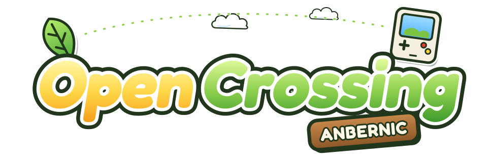

<p align="center">
  
</p>

<p align="center">
  <a href="https://github.com/TechProGabe/OpenCrossing-Anbernic/releases/latest"></a>
  <a href="https://github.com/TechProGabe/OpenCrossing-Anbernic/releases"></a>
  
  
</p>

Animal Crossing for the GameCube, running natively on Anbernic handhelds. No emulator. The game's own decompiled C code runs on the handheld's CPU, and a translation layer turns GameCube graphics calls into OpenGL ES.

It boots, renders and saves on real hardware at around 56 fps on an RG-34XX SP. It's still early, so expect the odd bug and save often.

Maintained by [TechProGabe](https://github.com/TechProGabe) and [Dia2809](https://github.com/Dia2809).

## Install

You need a PortMaster-capable device (muOS, Knulli and friends) and your own dump of **Animal Crossing (USA)**, game ID `GAFE01`. `.iso`, `.gcm` and `.ciso` all work. PAL and Japanese discs are not supported.

1. Grab `opencrossing-anbernic-vX.Y.Z-armhf.zip` from the [latest release](../../releases/latest) and unzip it.
2. Copy the `ports` folder to the root of your SD card. Merge it if one already exists.
3. Copy `Animal Crossing.sh` into `ROMS/Ports/`.
4. Put your disc image in `ports/ac-gc/rom/`.
5. Launch **Animal Crossing** from the Ports menu.

The first launch is slow because it builds a shader cache. After that it starts quickly. Saves, settings and logs all live in `ports/ac-gc/`. On Knulli that folder is `/userdata/roms/ports/ac-gc/`, and the launcher finds it either way.

Updating? Back up your saves, then copy the new files over the old ones.

## Devices

Every H700 Anbernic uses the same chip, so one build runs on all of them.

| Device | Screen | Status |
|---|---|---|
| RG-34XX SP | 720×480 | Tested (dev device) |
| RG34XX | 720×480 | Should work, same hardware as the SP |
| RG35XX SP / H / Plus / 2024 / Pro | 640×480 | Community tested |
| RG40XX V / H | 640×480 | Community tested |
| RG28XX | 640×480 | Community tested |
| RG CubeXX | 720×720 | Untested, expect letterboxing |

Older RG35XX models won't work. RK3566 and other Rockchip handhelds are untested: if your firmware ships 32-bit libraries, give it a go. Tried a device that isn't listed? Open an issue with `ports/ac-gc/log.txt` attached, whether it worked or not.

## Troubleshooting

When reporting a bug, attach `ports/ac-gc/log.txt`, plus `crash.log` from the same folder if the game crashed. The log is rewritten every launch.

- **"No game disc image found" or "Wrong game version":** your disc image is missing from `ports/ac-gc/rom/` or isn't the USA `GAFE01` release.
- **Black screen with no error:** that's a real bug. Please send the log.
- **No audio:** quit and launch again. The first start after install sometimes comes up silent.
- **Can't walk:** devices without an analog stick get D-pad walking automatically. To set it yourself, press Select, go to Control and turn on "Use Dpad as Joystick".
- **Wrong resolution:** the panel is detected at launch. To force one, uncomment `window_width` and `window_height` in `ports/ac-gc/settings.ini`.
- **Modded stock OS:** Select and Menu are swapped for all PortMaster games there. Menu opens settings and Select+Start quits.
- **Lid sleep acts weird on muOS clamshells:** that's a firmware quirk. Press power to wake.

## FAQ

**Do the NES games work?**
Yes, on `dev` builds and from the next release. The original game's emulator is PowerPC assembly, so the port runs the games with [fixNES](https://github.com/FIX94/fixNES) instead. Hold L1, R1 and R2 to go back to your room. High scores save. Clu Clu Land D is a Famicom Disk System game and won't start. The plain NES item plays `.nes` files you put in `ports/ac-gc/nes_roms/`.

**The gyroid at my door says "I am currently processing data" and won't save. Is saving broken?**
No. That's the gyroid saying no, same as on GameCube. Finish Nook's part-time job or chat with villagers until one remembers you, and saving unlocks. If a save really fails, the log will have a `GCI save:` line saying why.

**Why only the USA disc?**
The decompilation targets `GAFE01`, and the port expects that disc's exact data layout. PAL and JP releases are different builds of the game, so they're detected and refused at launch.

**Does the Deluxe mod work?**
Not yet. It's possible, but it's a big job.

**How much RAM does it need?**
It runs fine on both the 1 GB and 2 GB models.

**Desktop Linux or Windows?**
That's what the upstream PC port is for. See the credits below.

## Saves, settings and texture packs

- **Saves** are standard GCI files and work with Dolphin in both directions. Slot A lives in `save/card_a/` and Slot B in `save/card_b/`. With the game closed you can copy them out to back up, delete them for a fresh town, or drop in a Dolphin export. Saves are checksum checked on load, so use a save editor that fixes the checksum.
- **Settings** are in the in-game menu or `settings.ini`. The GAME tab has the gameplay options:
  - **Endless Acres** (on): the camera follows you smoothly from acre to acre instead of stopping at each edge.
  - **Bells to Wallet** (off): bell bags you pick up go straight into your wallet when they fit.
  - **Shop Upgrade** (on): Nook's can grow into Nookington's without a visitor from another town.
  - **Disable Resetti** (off).

  The other tabs cover FPS target, render scale, shadow, particle and acre quality, culling distance, volume and button bindings. The D-pad also works in menus and speeds up text.
- **Texture packs** use the Dolphin format (XXHash64 DDS) and go in `texture_pack/`. The [community HD pack](https://forums.dolphin-emu.org/Thread-animal-crossing-hd-texture-pack-version-23-feb-22nd-2026) works, but it costs some performance.

## Building

You only need this if you're working on the port. `main` is the release branch and `dev` is where daily work happens, so `dev` can break. To cross-build the device binary in Docker from any machine:

```bash
docker run --rm --platform linux/arm/v7 \
  -v "$PWD":/work \
  debian:bookworm bash /work/pc/build-armhf-docker.sh
```

The binary ends up at `pc/build-armhf/bin/AnimalCrossing`. On Windows you can skip Docker: `pip install cmake ninja`, then `python pc/tools/build_windows.py`. Desktop builds and more detail are in [BUILDING.md](BUILDING.md).

## Credits

- **[ACreTeam/ac-decomp](https://github.com/ACreTeam/ac-decomp)**, the full C decompilation of Animal Crossing. None of this exists without it.
- **[flyngmt/ACGC-PC-Port](https://github.com/flyngmt/ACGC-PC-Port)**, the original PC port and its GX to OpenGL layer.
- **[Dia2809/ACGC-PC-Port](https://github.com/Dia2809/ACGC-PC-Port)**, which added Linux support, the OpenGL ES renderer and the ARM branches this project started from.
- **[FIX94/fixNES](https://github.com/FIX94/fixNES)**, the NES emulator behind the NES furniture.

AI tools (Claude) helped with the porting and optimization work. That covers platform code only, not the decompiled game code.

## Legal

This is an unofficial fan project. It isn't affiliated with or endorsed by Nintendo. Animal Crossing and related names are Nintendo trademarks, used here only to describe what this works with. No game assets, disc contents or original code are included. You need your own legally obtained copy of the game.
